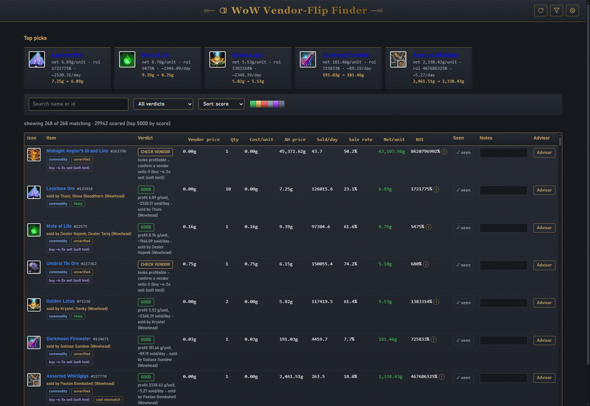
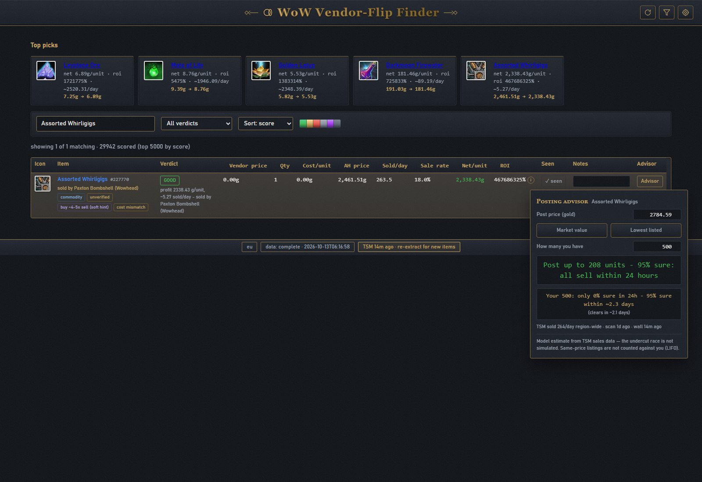

# WoW Vendor-Flip Finder

A local Windows tool that finds WoW retail items you can buy from an NPC
vendor and sell on the Auction House for profit. It combines TSM's free
public auction data with the Blizzard Game Data API, scores every candidate,
and includes a posting advisor that tells you how many units to post.

Everything runs on `127.0.0.1` - nothing is uploaded anywhere, and your
Blizzard credentials never leave `config.local.json`.



## Requirements

- Windows 10/11
- Python 3.11+ on PATH (`python --version`)

## Setup

1. Copy `config.local.json.example` to `config.local.json`.
2. Fill in `client_id` and `client_secret` from https://develop.battle.net
   (create a client, copy the OAuth credentials). The file is gitignored and
   the secret is never printed.
3. Double-click `start.cmd` - the server starts and your browser opens
   `http://127.0.0.1:8008`.

## Using it

- **First run:** open Settings -> "Re-extract vendor data". This refreshes
  the TSM auction data and then asks Blizzard about every item (~31k calls,
  ~1 hour). It is resumable - close the window and start again whenever.
  The same button re-runs a completed extraction from scratch; the CLI
  equivalent is `python tools\extract.py --restart`.
- **Top picks** shows the best GOOD items, falling back to the top CHECK
  VENDOR items while nothing is vendor-verified yet.
- **The table** is the full candidate list. Filters (search, verdict, sort,
  sliders) narrow it down. Click a name to open its Wowhead page, tick
  "seen" when you have confirmed the vendor sells it, and write notes
  (they persist).
- **Posting Advisor** - the `Advisor` button on every row:

  

  1. Enter a **post price** in gold, or jump to **Market value** /
     **Lowest listed**.
  2. Read the headline: "Post up to N units - 95% sure: all sell within
     24 hours." N is modeled from TSM's region-wide daily sales combined
     with the live auction wall in front of you.
  3. Optionally enter **How many you have** to check that exact stack: the
     popover tells you the chance it sells within 24 hours and the date it
     realistically clears.
  4. Treat it as an estimate: the undercut race is not simulated and
     same-price listings are not counted against you (LIFO).
- **Verdicts** (first match wins):
  - `GOOD` - clears your profit and ROI thresholds with recent sales.
  - `CHECK VENDOR` - economics look good but nothing is vendor-verified
    yet; go check the vendor in game.
  - `CHECK IN GAME` - vendor price is exactly 1 copper; verify manually.
  - `RISKY` - suspicious AH data (thin listings, stale prices, commodity
    quirks); only buy if you have checked the market yourself.
  - `NOT WORTH IT` - fails a hard rule (no AH price, ROI/profit below
    thresholds, etc.).
- **Settings** - region (eu/us) and icon host (Blizzard/Wowhead) without
  touching `config.local.json`; "Reset overrides" falls back to the file.
- **Data refresh** - auction data (TSM CSVs + live wall) refreshes in the
  background every time the app starts, and the status chip shows how old
  it is. TSM publishes new CSVs roughly every 3 hours. Vendor prices come
  from a one-time "Re-extract vendor data".

## Data & privacy

- AH prices come from TSM's public CSVs (no key, no sign-in).
- Vendor prices come from the Blizzard Game Data API with your own
  credentials.
- The SQLite database (`data/vendorflips.sqlite`) and TSM cache
  (`data/tsm/`) stay on your machine. The server binds to 127.0.0.1 only
  and rejects requests aimed at any other host.

## Tests

```
python -m unittest discover -s tests -v
```

## License

MIT - see [LICENSE](LICENSE).
