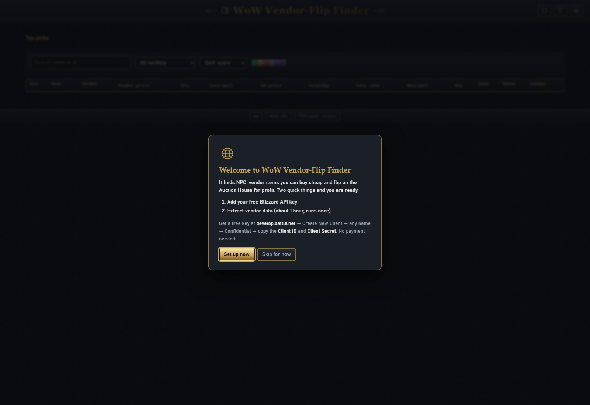
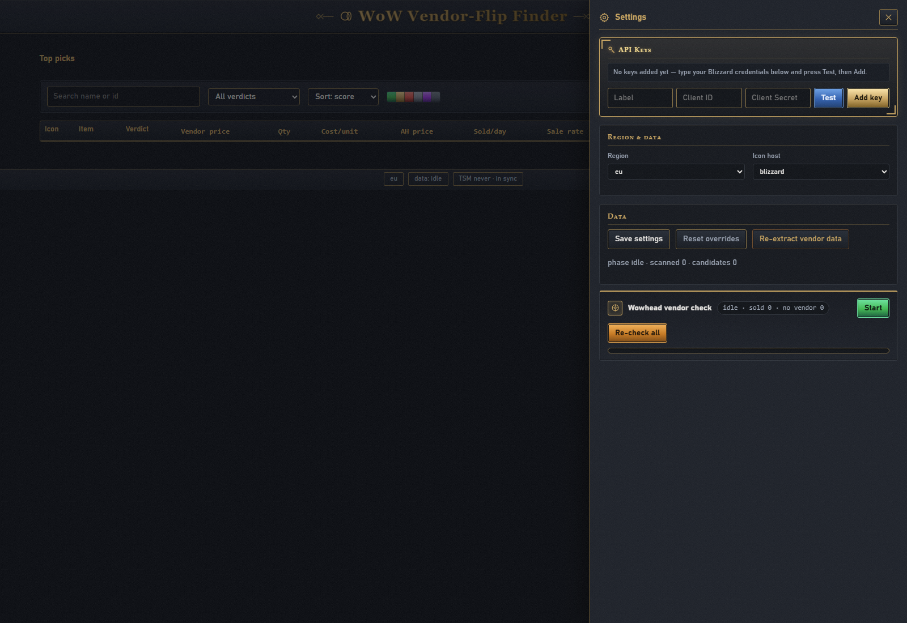

# WoW Vendor-Flip Finder

A local Windows tool that finds WoW retail items you can buy from an NPC
vendor and sell on the Auction House for profit. It combines TSM's free
public auction data with the Blizzard Game Data API, scores every candidate,
and includes a posting advisor that tells you how many units to post.

Everything runs on `127.0.0.1` - nothing is uploaded anywhere, and your
Blizzard credentials never leave your machine.


## Requirements

- Windows 10 or 11
- Python 3.11 or newer - download it from
  <https://www.python.org/downloads/> and **tick "Add python.exe to
  PATH"** during install. Open a new command prompt and check with
  `python --version`.

## Setup (5 minutes)

1. **Download the project**: on the GitHub page press the green
   **Code** button -> **Download ZIP**, then unzip it anywhere
   (for example `Documents\wow-vendor-flip`).
2. **Start it**: double-click **`start.cmd`**. A console window opens
   and your browser opens `http://127.0.0.1:8008`.
   - If it says *"Python was not found on PATH"*: install Python
     (see Requirements, tick "Add python.exe to PATH"), then try again.
3. **The setup wizard appears automatically** on your first run:

   

   1. **Welcome** - press *Set up now*.
   2. **Step 1 - Add your API key**: get a free key at
      <https://develop.battle.net> - *Create New Client* -> any name
      -> *Confidential* -> copy the **Client ID** and **Client
      Secret**. Paste both, press *Test*, then *Add key*, then
      *Continue*.
   3. **Step 2 - Extract vendor data**: pick your region (eu/us) and
      press *Start extraction*. It asks Blizzard about every item
      (~31k calls, about 1 hour). It is resumable - close the app and
      start it again whenever, it continues where it left off. When it
      finishes the wizard shows *All done!*.

Pressed *Skip for now*? A small **Open setup** banner at the top of
the window stays there until setup is complete.

API keys are free - no payment, no sign-up needed beyond the
developer account.

## Using it

- **Top picks** shows the best GOOD items, falling back to the top CHECK
  VENDOR items while nothing is vendor-verified yet.
- **The table** is the full candidate list. Filters (search, verdict, sort,
  sliders) narrow it down. Click a name to open its Wowhead page, tick
  "seen" when you have confirmed the vendor sells it, and write notes
  (they persist).
- **Posting Advisor** - the `Advisor` button on every row:

  

  1. Enter a **post price** in gold, or jump to **Market value** /
     **Lowest listed**.
  2. Read the headline: "Post up to N units - 95% sure: all sell within
     24 hours." N is modeled from TSM's region-wide daily sales combined
     with the live auction wall in front of you.
  3. Optionally enter **How many you have** to check that exact stack: the
     popover tells you the chance it sells within 24 hours and the date it
     realistically clears.
  4. Treat it as an estimate: the undercut race is not simulated and
     same-price listings are not counted against you (LIFO).
- **Verdicts** (first match wins):
  - `GOOD` - clears your profit and ROI thresholds with recent sales.
  - `CHECK VENDOR` - economics look good but nothing is vendor-verified
    yet; go check the vendor in game.
  - `CHECK IN GAME` - vendor price is exactly 1 copper; verify manually.
  - `RISKY` - suspicious AH data (thin listings, stale prices, commodity
    quirks); only buy if you have checked the market yourself.
  - `NOT WORTH IT` - fails a hard rule (no AH price, ROI/profit below
    thresholds, etc.).
- **Data refresh** - auction data (TSM CSVs + live wall) refreshes in the
  background every time the app starts, and the status chip shows how old
  it is. TSM publishes new CSVs roughly every 3 hours. Vendor prices come
  from the one-time extraction the wizard runs.

## Settings & API keys

Press **Settings** (gear icon, top right) to open the panel:



- **API Keys** - paste a Client ID and Client Secret, press *Test* to
  check them, then *Add key* to save. You can store several keys: the
  app uses the first working one and automatically rotates to another
  when a key hits a rate limit. Keys stay in the local database only.
- **Region & Data** - switch region (eu/us) and icon host (Blizzard or
  Wowhead), then *Save settings*. *Reset overrides* falls back to the
  defaults from `config.local.json`.
- **Data** - shows the extraction status and has *Re-extract vendor
  data*, which re-runs the extraction from scratch (the same thing the
  wizard started) - the CLI equivalent is `python tools\extract.py
  --restart`.

Prefer a file instead of the wizard? Copy `config.local.json.example`
to `config.local.json` and fill in `client_id` / `client_secret`; the
file is gitignored and the secret is never printed.

## Data & privacy

- AH prices come from TSM's public CSVs (no key, no sign-in).
- Vendor prices come from the Blizzard Game Data API with your own
  free credentials.
- Everything stays on your machine: the SQLite database
  (`data/vendorflips.sqlite`), the TSM cache (`data/tsm/`) and your
  API keys (in the database, or in `config.local.json` if you use
  that file).
- The server binds to 127.0.0.1 only and rejects requests aimed at
  any other host.

## Tests

```
python -m unittest discover -s tests -v
```

## Credits

Built with assistance from OpenCode (an AI coding agent).

## License

MIT - see [LICENSE](LICENSE).
